<!-- _class: part -->

# Phần I. Giới thiệu

Bệnh trên lá và chẩn đoán trên điện thoại

<!--
Phần đầu nói vì sao cần đề tài này: bệnh trên lá gây thiệt hại thế nào, người ta chẩn đoán bệnh ra sao, và luận văn làm gì.
-->

---

# Bệnh trên lá: mất mùa mỗi năm

<!-- _footer: "[1] S. Savary, L. Willocquet, S. J. Pethybridge, P. Esker, N. McRoberts, và A. Nelson, “The global burden of pathogens and pests on major food crops”, Nature Ecology & Evolution, vol 3, số p.h 3, tr 430–439, 2019. [6] Đ. P. Vũ, “Một số kết quả nghiên cứu bệnh gỉ sắt cà phê Hemileia vastatrix B et Br và biện pháp phòng trừ trong điều kiện vùng Tây Bắc Việt Nam”, Luận án Phó tiến sĩ Nông nghiệp, Viện Khoa học Nông nghiệp Việt Nam, Hà Nội, 1993. [7] M. Đảm, “Hiện tượng cháy lá sầu riêng gia tăng và khuyến cáo phòng trị”. Báo Nông nghiệp Việt Nam, Tháng Ba 2024." -->

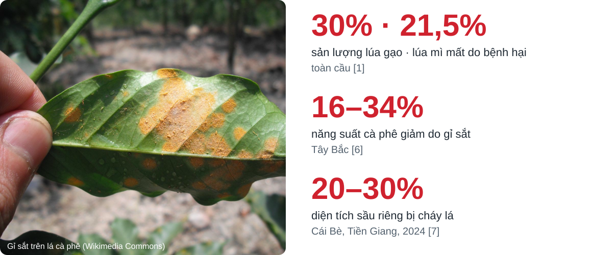

<!--
Bệnh trên lá gây thiệt hại lớn cho nông nghiệp. Trên thế giới, bệnh hại làm mất khoảng 30% sản lượng lúa gạo và hơn 21% sản lượng lúa mì.
Ở Việt Nam, nông lâm nghiệp chiếm khoảng 11,6% GDP. Cà phê và sầu riêng là hai cây chủ lực: Việt Nam sản xuất cà phê Robusta nhiều nhất thế giới, còn sầu riêng xuất khẩu gần 3,2 tỷ USD năm 2024.
Hai cây này đều bị bệnh lá. Gỉ sắt, như trong ảnh, từng làm năng suất cà phê ở Tây Bắc giảm 16 đến 34%. Năm 2024, 20 đến 30% diện tích sầu riêng ở Cái Bè bị cháy lá.
Vì vậy, phát hiện bệnh sớm là việc cần thiết.

(Ghi chú: ảnh gỉ sắt lấy từ Wikimedia Commons, cần kiểm tra tác giả và giấy phép.)
-->

---

# Chẩn đoán bệnh trên lá thế nào?

<!-- _footer: "[8] S. P. Mohanty, D. P. Hughes, và M. Salathé, “Using Deep Learning for Image-Based Plant Disease Detection”, Frontiers in Plant Science, vol 7, tr 1419, 2016. [9] A. Ramcharan và c.s., “A Mobile-Based Deep Learning Model for Cassava Disease Diagnosis”, Frontiers in Plant Science, vol 10, tr 272, 2019." -->

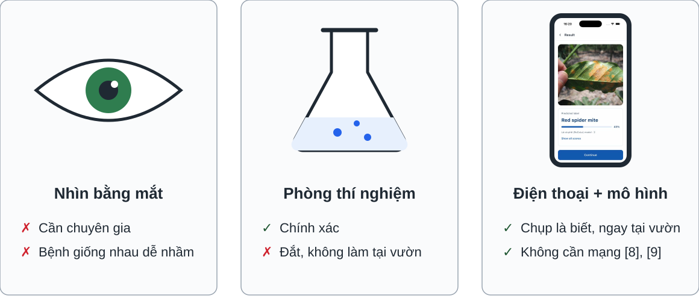

<!--
Hiện nay có ba cách chẩn đoán.
Cách phổ biến nhất là nhìn bằng mắt. Cách này cần người có kinh nghiệm, và dễ nhầm khi nhiều bệnh có triệu chứng giống nhau. Ví dụ, lá sầu riêng bị cháy chưa chắc là do nấm: ở Tiền Giang, phần lớn là do cây suy kiệt gặp nắng nóng.
Cách thứ hai là gửi mẫu vào phòng thí nghiệm. Kết quả chính xác hơn, nhưng tốn tiền và không làm ngay tại vườn được.
Cách thứ ba là dùng điện thoại. Người dùng chụp ảnh lá, một mô hình học sâu nhỏ chạy ngay trên máy và cho kết quả, không cần mạng. Luận văn đi theo hướng này.
-->

---

# Phòng thí nghiệm khác thực địa

<!-- _footer: "[8] S. P. Mohanty, D. P. Hughes, và M. Salathé, “Using Deep Learning for Image-Based Plant Disease Detection”, Frontiers in Plant Science, vol 7, tr 1419, 2016. [11] J. Parraga-Alava, K. Cusme, A. Loor, và E. Santander, “RoCoLe: A robusta coffee leaf images dataset for evaluation of machine learning based methods in plant diseases recognition”, Data in Brief, vol 25, tr 104414, 2019. [14] T. N. Thanh, L. X. Nguyen, T. Cap, và T. Le, “A durian leaf image dataset of common diseases in Vietnam for agricultural diagnosis”, Data in Brief, vol 61, tr 111845, 2025." -->

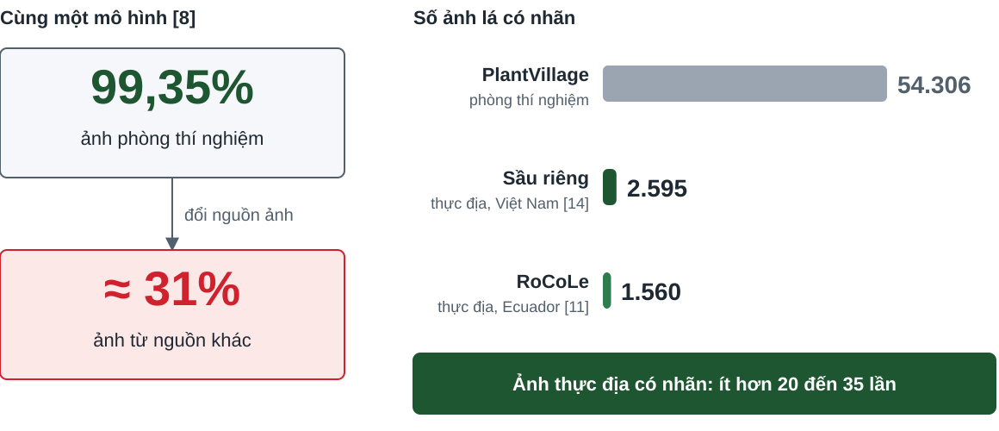

<!--
Nhưng mô hình trên điện thoại gặp một vấn đề. Mohanty và cộng sự huấn luyện mô hình trên bộ PlantVillage, gồm ảnh chụp trong phòng thí nghiệm, và đạt 99,35%. Khi thử trên ảnh từ nguồn khác, độ chính xác chỉ còn khoảng 31%.
Nguyên nhân chính là dữ liệu. PlantVillage có hơn 54 nghìn ảnh. Hai bộ ảnh chụp ngoài vườn mà luận văn dùng nhỏ hơn rất nhiều: sầu riêng có 2.595 ảnh, RoCoLe có 1.560 ảnh lá cà phê. Tức là ít hơn 20 đến 35 lần.
-->

---

# Huấn luyện một lần là chưa đủ

<!-- _footer: "[13] D. Kreuzberger, N. Kühl, và S. Hirschl, “Machine Learning Operations (MLOps): Overview, Definition, and Architecture”, IEEE Access, vol 11, tr 31866–31879, 2023." -->

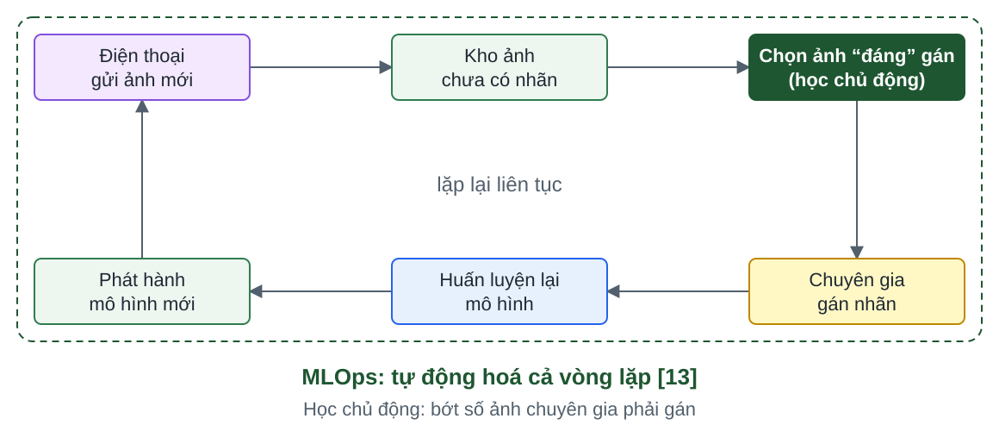

<!--
Vì ảnh thực địa có nhãn còn ít, huấn luyện một lần là chưa đủ. Mô hình cần học tiếp từ ảnh người dùng gửi về.
Vòng lặp trên slide là như vậy. Điện thoại gửi ảnh mới vào kho. Hệ thống chọn ra những ảnh đáng gán nhãn. Chuyên gia gán nhãn. Mô hình được huấn luyện lại, rồi bản mới được phát hành về điện thoại.
MLOps giúp tự động hoá cả vòng này. Còn học chủ động giúp chọn đúng ảnh, để chuyên gia không phải gán nhãn quá nhiều.
-->

---

# Mục tiêu: ba phần nối nhau

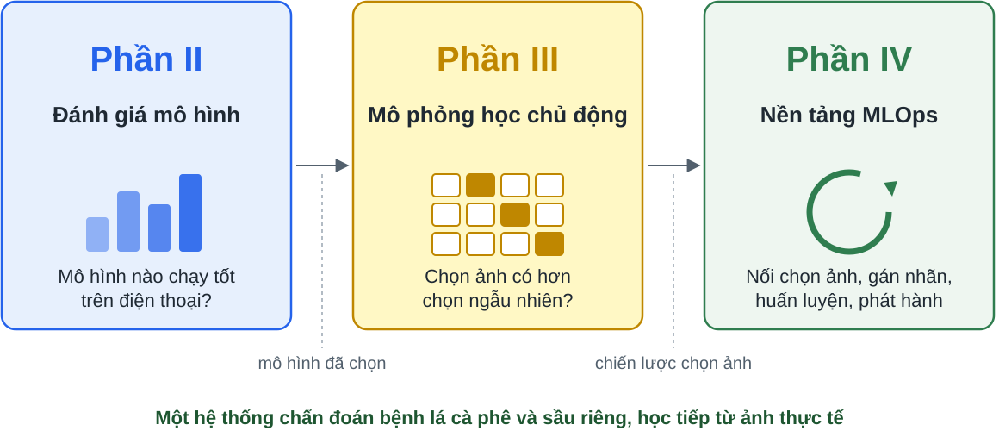

<!--
Từ đó, mục tiêu của luận văn là xây dựng một hệ thống chẩn đoán bệnh lá cà phê và sầu riêng, học tiếp được từ ảnh thực tế với chi phí gán nhãn thấp. Luận văn gồm ba phần nối nhau.
Phần II so sánh tám mô hình để chọn một mô hình chạy tốt trên điện thoại.
Phần III dùng mô hình đó để thử xem chọn ảnh bằng học chủ động có tốt hơn chọn ngẫu nhiên không.
Phần IV xây một nền tảng MLOps, nối việc chọn ảnh, gán nhãn, huấn luyện và phát hành thành một vòng.
-->

---

<!-- _class: part -->

# Phần II. Đánh giá mô hình thị giác máy tính

Mô hình nào chạy tốt trên điện thoại?

<!--
Phần này so sánh tám mô hình trên hai bộ ảnh lá, rồi chọn một mô hình cho ứng dụng điện thoại.
-->

---

# Hai bộ dữ liệu ảnh lá thực địa

<!-- _footer: "[11] J. Parraga-Alava, K. Cusme, A. Loor, và E. Santander, “RoCoLe: A robusta coffee leaf images dataset for evaluation of machine learning based methods in plant diseases recognition”, Data in Brief, vol 25, tr 104414, 2019. [14] T. N. Thanh, L. X. Nguyen, T. Cap, và T. Le, “A durian leaf image dataset of common diseases in Vietnam for agricultural diagnosis”, Data in Brief, vol 61, tr 111845, 2025." -->

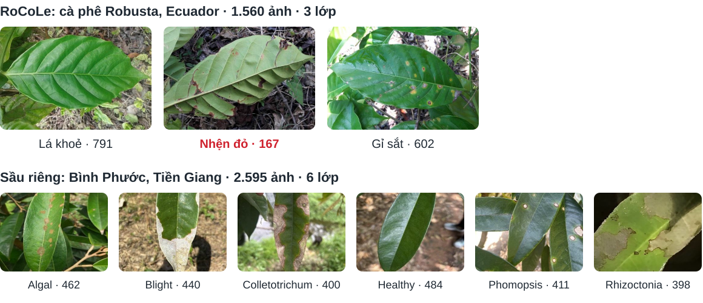

<!--
Luận văn dùng hai bộ ảnh đều chụp ngoài vườn.
RoCoLe có 1.560 ảnh lá cà phê Robusta, chụp bằng điện thoại trên một cánh đồng ở Ecuador. Bộ này có ba lớp: lá khoẻ, nhện đỏ và gỉ sắt.
Bộ sầu riêng có 2.595 ảnh, chụp bằng iPhone ở các vườn tại Bình Phước và Tiền Giang, với sáu lớp: bốn bệnh, đốm rong và lá khoẻ.
-->

---

# Một bộ lệch, một bộ cân bằng

<!-- _footer: "[11] J. Parraga-Alava, K. Cusme, A. Loor, và E. Santander, “RoCoLe: A robusta coffee leaf images dataset for evaluation of machine learning based methods in plant diseases recognition”, Data in Brief, vol 25, tr 104414, 2019. [14] T. N. Thanh, L. X. Nguyen, T. Cap, và T. Le, “A durian leaf image dataset of common diseases in Vietnam for agricultural diagnosis”, Data in Brief, vol 61, tr 111845, 2025." -->

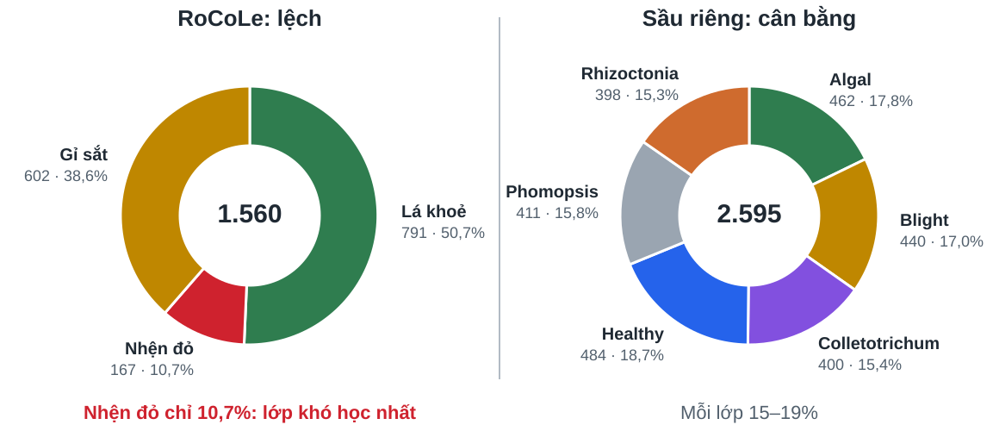

<!--
Hai bộ dữ liệu khác nhau về tỉ lệ lớp. Ở RoCoLe, nhện đỏ chỉ có 167 ảnh, khoảng 11%, nên đây là lớp khó học nhất. Bộ sầu riêng cân bằng, mỗi lớp chiếm 15 đến 19%.
Nhờ vậy, luận văn đánh giá được mô hình, và sau này là chiến lược chọn ảnh, trong hai điều kiện dữ liệu khác nhau.
-->

---

# Tám mô hình, ba họ kiến trúc

<!-- _footer: "[28] H. Touvron, M. Cord, M. Douze, F. Massa, A. Sablayrolles, và H. Jégou, “Training data-efficient image transformers & distillation through attention”, trong Proceedings of the 38th International Conference on Machine Learning, PMLR, vol. 139, 2021, tr 10347–10357. [30] P. K. Anasosalu Vasu, J. Gabriel, J. Zhu, O. Tuzel, và A. Ranjan, “FastViT: A Fast Hybrid Vision Transformer using Structural Reparameterization”, trong 2023 IEEE/CVF International Conference on Computer Vision (ICCV), IEEE, 2023, tr 5762–5772. [35] A. Howard và c.s., “Searching for MobileNetV3”, trong 2019 IEEE/CVF International Conference on Computer Vision (ICCV), IEEE, 2019, tr 1314–1324. [36] D. Qin và c.s., “MobileNetV4: Universal Models for the Mobile Ecosystem”, trong Computer Vision – ECCV 2024, Springer Nature Switzerland, 2024, tr 78–96. [37] M. Tan và Q. V. Le, “EfficientNetV2: Smaller Models and Faster Training”, trong Proceedings of the 38th International Conference on Machine Learning, PMLR, vol. 139, 2021, tr 10096–10106. [38] Z. Liu, H. Mao, C.-Y. Wu, C. Feichtenhofer, T. Darrell, và S. Xie, “A ConvNet for the 2020s”, trong 2022 IEEE/CVF Conference on Computer Vision and Pattern Recognition (CVPR), IEEE, 2022, tr 11966–11976. [39] Z. Liu và c.s., “Swin Transformer: Hierarchical Vision Transformer using Shifted Windows”, trong 2021 IEEE/CVF International Conference on Computer Vision (ICCV), IEEE, 2021, tr 9992–10002. [40] S. Mehta và M. Rastegari, “Separable Self-attention for Mobile Vision Transformers”, Transactions on Machine Learning Research, 2023." -->

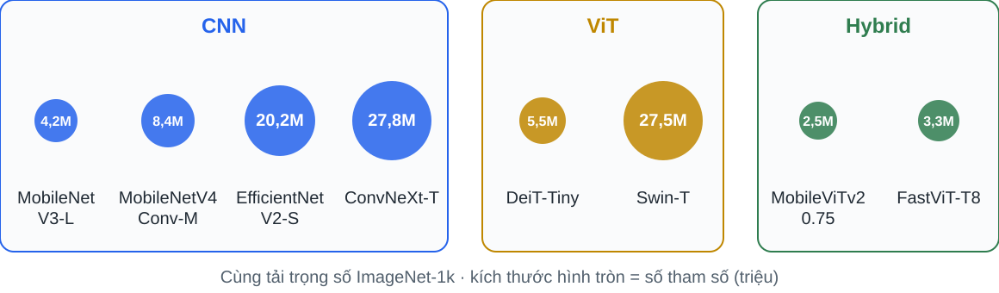

<!--
Luận văn so sánh tám mô hình thuộc ba họ.
Họ mạng tích chập, CNN, có MobileNetV3, MobileNetV4, EfficientNetV2 và ConvNeXt. Họ Transformer thị giác, ViT, có DeiT và Swin. Họ lai giữa hai loại này có MobileViTv2 và FastViT.
Các mô hình được chọn theo họ và theo kích thước, ưu tiên mô hình nhỏ để chạy được trên điện thoại. Tất cả đều dùng trọng số đã huấn luyện sẵn trên ImageNet-1k.
-->

---

# Học chuyển giao hai bước (LP-FT)

<!-- _footer: "[30] P. K. Anasosalu Vasu, J. Gabriel, J. Zhu, O. Tuzel, và A. Ranjan, “FastViT: A Fast Hybrid Vision Transformer using Structural Reparameterization”, trong 2023 IEEE/CVF International Conference on Computer Vision (ICCV), IEEE, 2023, tr 5762–5772. [39] Z. Liu và c.s., “Swin Transformer: Hierarchical Vision Transformer using Shifted Windows”, trong 2021 IEEE/CVF International Conference on Computer Vision (ICCV), IEEE, 2021, tr 9992–10002. [41] A. Kumar, A. Raghunathan, R. Jones, T. Ma, và P. Liang, “Fine-Tuning can Distort Pretrained Features and Underperform Out-of-Distribution”, trong International Conference on Learning Representations (ICLR), 2022. [46] I. Loshchilov và F. Hutter, “Decoupled Weight Decay Regularization,” in Proc. Int. Conf. Learning Representations (ICLR), 2019." -->

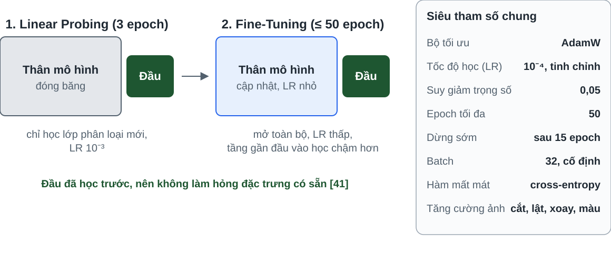

<!--
Mọi mô hình được huấn luyện theo cùng một cách, gọi là LP-FT, gồm hai bước.
Bước một, Linear Probing: giữ nguyên thân mô hình, chỉ học lớp phân loại mới trong 3 epoch.
Bước hai, Fine-Tuning: mở toàn bộ mô hình và huấn luyện tiếp với tốc độ học thấp; các tầng gần đầu vào học chậm hơn.
Kumar và cộng sự chỉ ra rằng nếu fine-tune ngay với một lớp phân loại khởi tạo ngẫu nhiên, gradient lớn và nhiễu sẽ làm hỏng đặc trưng đã học. Học lớp phân loại trước thì tránh được việc này.
Bảng bên phải là các siêu tham số dùng chung. Batch cố định ở 32, không tinh chỉnh: theo Tuning Playbook, batch được chọn theo phần cứng, rồi tinh chỉnh tốc độ học cho batch đó.
-->

---

# Tinh chỉnh siêu tham số

<!-- _footer: "[47] V. Godbole, G. E. Dahl, J. Gilmer, C. J. Shallue, và Z. Nado, “Deep Learning Tuning Playbook,” 2023." -->

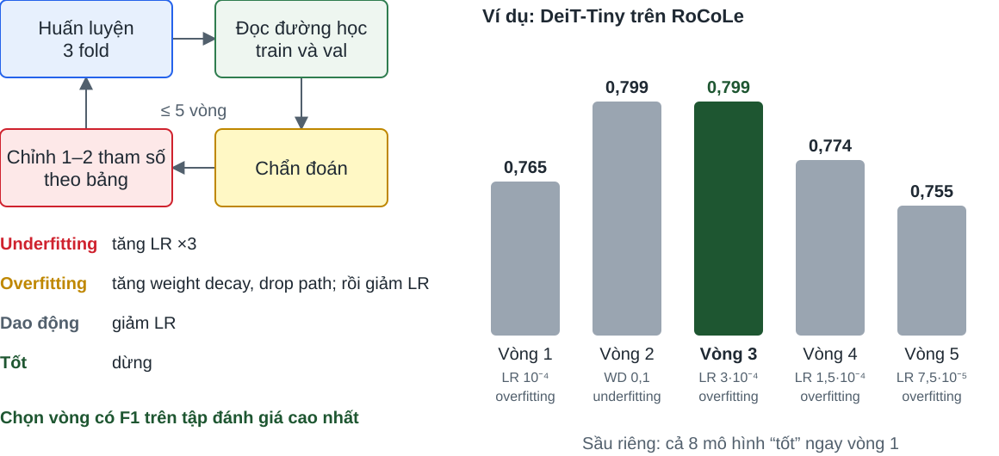

<!--
Mỗi mô hình có ngân sách tinh chỉnh như nhau: tối đa năm vòng, mỗi vòng huấn luyện trên ba fold.
Sau mỗi vòng, đọc đường học trên tập huấn luyện và tập đánh giá để chẩn đoán. Underfitting thì tăng tốc độ học. Overfitting thì tăng suy giảm trọng số và drop path, nếu vẫn overfitting thì giảm tốc độ học. Dao động thì giảm tốc độ học. Tốt thì dừng.
Ví dụ DeiT-Tiny trên RoCoLe: vòng ba đạt F1 trên tập đánh giá cao nhất, 0,799, nên được chọn. Trên sầu riêng, cả tám mô hình đã tốt ngay vòng đầu.
-->

---

# Chia dữ liệu và đánh giá

<!-- _footer: "[48] X. Bouthillier et al., “Accounting for Variance in Machine Learning Benchmarks,” in Proc. Machine Learning and Systems (MLSys), vol. 3, 2021, pp. 747–769." -->

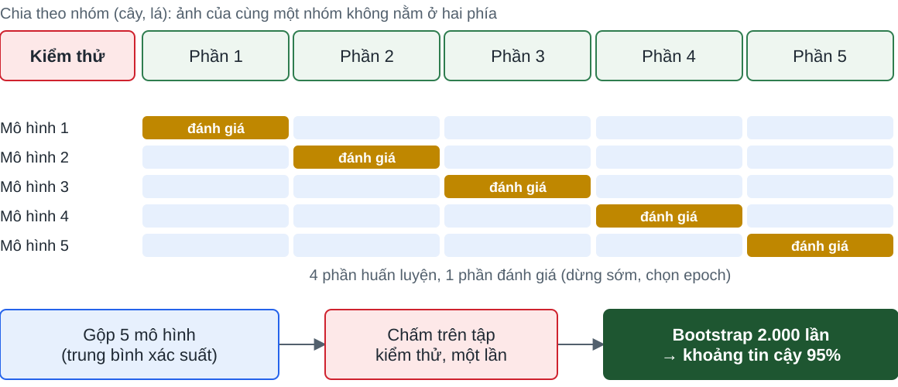

<!--
Trước hết, tập kiểm thử được tách riêng theo nhóm, để ảnh của cùng một cây hay một lá không nằm ở cả hai phía. Sau khi bỏ ảnh trùng, RoCoLe còn 1.437 ảnh, tập kiểm thử 226 ảnh; sầu riêng còn 2.374 ảnh, tập kiểm thử 398 ảnh.
Phần còn lại chia làm năm phần. Mỗi lần, mô hình học trên bốn phần và dùng phần còn lại để dừng sớm. Năm mô hình được gộp lại và chấm trên tập kiểm thử đúng một lần.
Khoảng tin cậy 95% tính bằng bootstrap 2.000 lần trên tập kiểm thử. Hai khoảng tin cậy chồng nhau thì không kết luận mô hình nào tốt hơn.
-->

---

# Kết quả: macro-F1 trên tập kiểm thử

| Mô hình | Họ | RoCoLe | KTC 95% | Sầu riêng | KTC 95% |
|---|---|---|---|---|---|
| **Swin-T** | ViT | **0,816** | 0,736–0,888 | **0,965** | 0,945–0,981 |
| **DeiT-Tiny** | ViT | **0,800** | 0,725–0,865 | **0,960** | 0,939–0,978 |
| MobileViTv2-0.75 | Hybrid | 0,762 | 0,672–0,843 | 0,940 | 0,915–0,962 |
| MobileNetV4-Conv-M | CNN | 0,753 | 0,666–0,826 | 0,942 | 0,917–0,964 |
| FastViT-T8 | Hybrid | 0,751 | 0,665–0,830 | 0,946 | 0,922–0,967 |
| ConvNeXt-T | CNN | 0,751 | 0,668–0,828 | 0,960 | 0,940–0,978 |
| MobileNetV3-L | CNN | 0,677 | 0,603–0,750 | 0,935 | 0,908–0,958 |
| EfficientNetV2-S | CNN | 0,672 | 0,601–0,746 | 0,953 | 0,930–0,972 |

<!--
Trên RoCoLe, hai mô hình ViT dẫn đầu: Swin-T 0,816 và DeiT-Tiny 0,800. Khoảng tin cậy của hai mô hình chồng nhau, nên không nói được mô hình nào hơn.
Trên sầu riêng, mọi mô hình đều trên 0,93; Swin-T cao nhất, 0,965, rồi đến ConvNeXt-T và DeiT-Tiny cùng 0,960.
Ở mọi mô hình, F1 của lớp nhện đỏ vẫn thấp, vì lớp này quá ít ảnh.
-->

---

# Kích thước và tốc độ của tám mô hình

| Mô hình | Họ | Tham số (triệu) | GFLOPs | ONNX (MB) | CPU 6 luồng (ms) | CPU 1 luồng (ms) |
|---|---|---|---|---|---|---|
| MobileNetV3-L | CNN | 4,2 | **0,43** | 16,2 | **2,2** | **5,3** |
| MobileNetV4-Conv-M | CNN | 8,4 | 2,16 | 32,3 | 6,7 | 18,9 |
| FastViT-T8 | Hybrid | 3,3 | 1,37 | 12,6 | 7,8 | 22,4 |
| MobileViTv2-0.75 | Hybrid | **2,5** | 2,06 | **10,1** | 9,9 | 23,7 |
| **DeiT-Tiny** | ViT | 5,5 | 2,15 | 21,6 | 11,2 | 26,2 |
| EfficientNetV2-S | CNN | 20,2 | 10,61 | 77,2 | 34,8 | 100,0 |
| ConvNeXt-T | CNN | 27,8 | 8,91 | 106,5 | 36,4 | 96,9 |
| Swin-T | ViT | 27,5 | 8,98 | 108,1 | 41,3 | 100,4 |

<!--
Bảng này đo chi phí của từng mô hình: số tham số, số phép tính cho một ảnh (GFLOPs), dung lượng tệp ONNX và độ trễ suy luận trên CPU với 6 luồng và 1 luồng.
MobileNetV3-L nhanh nhất: 2,2 ms với 6 luồng. MobileViTv2 nhỏ nhất: 2,5 triệu tham số, tệp 10 MB.
Swin-T, ConvNeXt-T và EfficientNetV2-S nặng nhất: trên 20 triệu tham số, tệp 77 đến 108 MB, chậm hơn DeiT-Tiny khoảng ba đến bốn lần.
DeiT-Tiny ở giữa: 5,5 triệu tham số, tệp 22 MB, 11 ms với 6 luồng.
-->

---

# Chọn mô hình: chính xác và nhanh

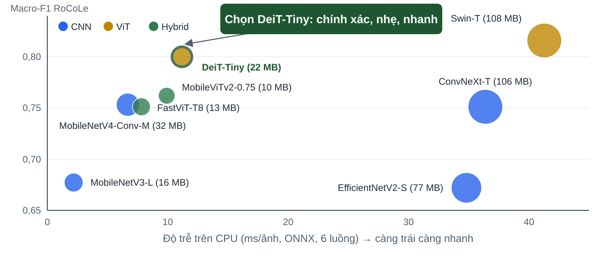

<!--
Mô hình chạy trên điện thoại nên phải cân cả độ chính xác lẫn chi phí. Hình đặt macro-F1 trên RoCoLe theo độ trễ trên CPU; kích thước hình tròn là dung lượng tệp mô hình.
Swin-T chính xác nhất nhưng chậm khoảng bốn lần và nặng gấp năm lần DeiT-Tiny. MobileNetV3 nhanh nhất nhưng kém chính xác nhất.
DeiT-Tiny cân bằng tốt nhất: F1 0,800, khoảng 11 ms một ảnh, tệp 22 MB. Luận văn chọn DeiT-Tiny cho ứng dụng và cho phần giả lập học chủ động.
-->
---

<!-- _class: part -->

# Phần III. Mô phỏng học chủ động

Gán nhãn ảnh nào trước khi chuyên gia có hạn?

---

# Vấn đề: ít ảnh lá thực địa có nhãn

<!-- _footer: "[8] S. P. Mohanty, D. P. Hughes, và M. Salathé, “Using Deep Learning for Image-Based Plant Disease Detection”, Frontiers in Plant Science, vol 7, tr 1419, 2016. [11] J. Parraga-Alava, K. Cusme, A. Loor, và E. Santander, “RoCoLe: A robusta coffee leaf images dataset for evaluation of machine learning based methods in plant diseases recognition”, Data in Brief, vol 25, tr 104414, 2019. [14] T. N. Thanh, L. X. Nguyen, T. Cap, và T. Le, “A durian leaf image dataset of common diseases in Vietnam for agricultural diagnosis”, Data in Brief, vol 61, tr 111845, 2025." -->

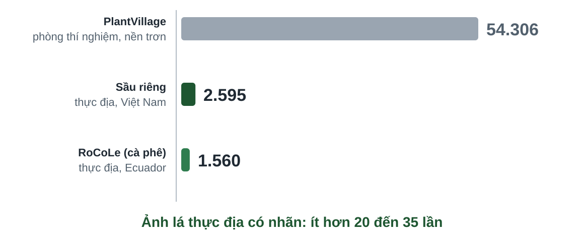

<!--
Ảnh lá ngoài vườn khác ảnh phòng thí nghiệm: nền rối, ánh sáng thay đổi, lá che nhau. Mô hình học trên ảnh nền trơn chẩn đoán kém ngoài thực địa.
Bộ thực địa thì rất nhỏ: sầu riêng (dữ liệu Việt Nam) 2.595 ảnh, RoCoLe 1.560 ảnh, so với 54.306 ảnh của PlantVillage. Gán thêm nhãn cần chuyên gia nông nghiệp, nên tốn kém.
Nguồn: PlantVillage theo Mohanty và cộng sự [8]; RoCoLe [11]; sầu riêng [14].
-->

---

# Cơ hội và khó khăn

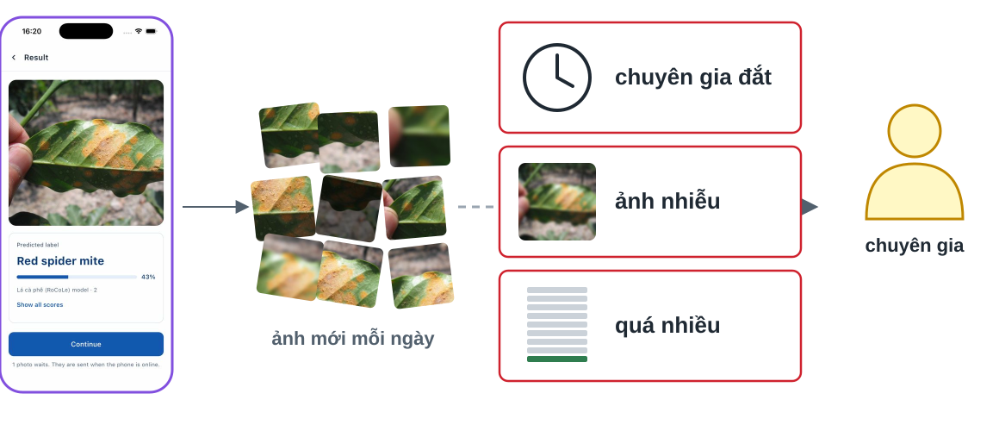

<!--
Cơ hội: người dùng ứng dụng chụp ảnh lá ngoài vườn mỗi ngày. Đó chính là ảnh thực địa ta đang thiếu.
Khó khăn: muốn dùng được thì ảnh phải có nhãn, mà nhãn cần chuyên gia nông nghiệp. Chuyên gia ít và đắt; ảnh gửi về nhiều ảnh mờ, tối, không phải lá; và số ảnh vượt xa số ảnh chuyên gia gán kịp.
Vì vậy không thể gán hết: phải chọn ra một phần nhỏ đáng gán nhất.
-->

---

# Câu hỏi

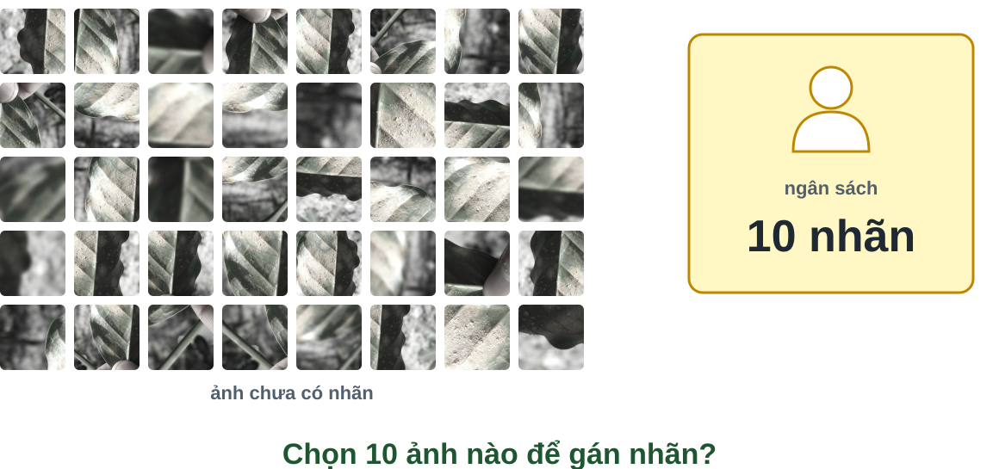

<!--
Chuyên gia chỉ gán được một ít ảnh mỗi lần, ví dụ 10 ảnh. Trong pool có hàng trăm ảnh chưa nhãn.
Chọn ngẫu nhiên thì dễ phí nhãn vào ảnh mô hình đã biết. Câu hỏi là: chọn 10 ảnh nào để mô hình học được nhiều nhất?
-->

---

# Học chủ động: để mô hình chọn ảnh cần gán

<!-- _footer: "[31] B. Settles, “Active Learning Literature Survey”, University of Wisconsin–Madison, Computer Sciences Technical Report 1648, 2009." -->

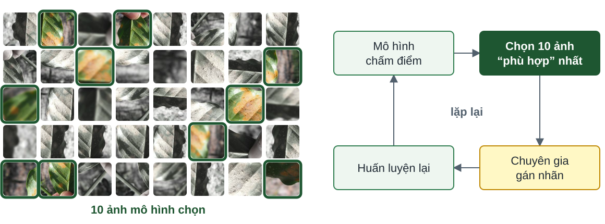

<!--
Học chủ động (Active Learning): thay vì chọn ngẫu nhiên, để mô hình chọn ảnh nào đáng gán nhãn nhất.
Vòng lặp: mô hình chấm điểm mọi ảnh chưa nhãn, chọn 10 ảnh "phù hợp" nhất theo một chiến lược, chuyên gia gán nhãn, huấn luyện lại, rồi lặp lại.
"Phù hợp" tùy chiến lược: ảnh mô hình kém chắc nhất, hoặc ảnh có thể thuộc lớp hiếm. Hai slide chiến lược phía sau nói rõ.
-->

---

# Vì sao cần giả lập?

<!-- _footer: "[33] N. Beck, D. Sivasubramanian, A. Dani, G. Ramakrishnan, và R. Iyer, “Effective Evaluation of Deep Active Learning on Image Classification Tasks”. arXiv:2106.15324. ICML 2021 Workshop on Subset Selection in Machine Learning, 2021. [34] P. Munjal, N. Hayat, M. Hayat, J. Sourati, và S. Khan, “Towards Robust and Reproducible Active Learning Using Neural Networks”, trong 2022 IEEE/CVF Conference on Computer Vision and Pattern Recognition (CVPR), IEEE, 2022, tr 223–232." -->

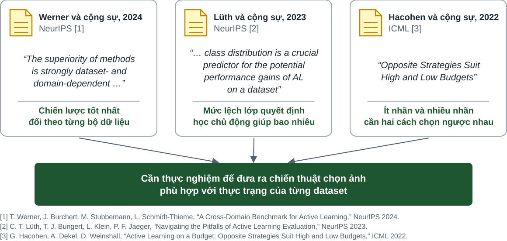

<!--
Các nghiên cứu so sánh học chủ động chưa thống nhất.
Tăng cường dữ liệu cũng là một cách điều chuẩn. Hai nhóm khác nhau ở mức độ.
Beck và cộng sự [33] huấn luyện có tăng cường ảnh cơ bản (lật, cắt). Với cách này, học chủ động cần ít nhãn hơn chọn ngẫu nhiên từ 2 đến 4 lần. Cách chọn đơn giản theo độ bất định đã đủ tốt. Họ cũng thấy mỗi lớp càng ít ảnh thì học chủ động càng ít cơ hội vượt chọn ngẫu nhiên.
Munjal và cộng sự [34] điều chuẩn mạnh hơn: RandAugment và SWA. Khi đó chọn ngẫu nhiên cũng tăng mạnh, và chênh lệch giữa các cách chọn trở nên không đáng kể. Không chiến lược nào hơn chọn ngẫu nhiên một cách ổn định.
Vì vậy cần thực nghiệm trên chính bộ dữ liệu của luận văn: RoCoLe (lệch lớp, nhện đỏ hiếm) và sầu riêng (khá cân bằng).
-->

---

# Chiến lược bất định: chọn ảnh mô hình phân vân

<!-- _footer: "[31] B. Settles, “Active Learning Literature Survey”, University of Wisconsin–Madison, Computer Sciences Technical Report 1648, 2009." -->

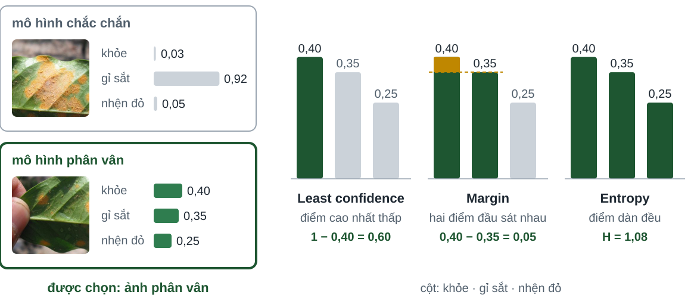

<!--
Ba chiến lược bất định (uncertainty sampling) dùng cùng một lần suy luận trên pool, chỉ khác cách tính điểm từ vector xác suất.
Least confidence: 1 trừ xác suất cao nhất. Margin: khoảng cách giữa hai xác suất đầu, càng nhỏ càng phân vân. Entropy: độ dàn đều của cả phân phối.
Điểm số trên slide là ví dụ minh hoạ.
-->

---

# Mốc so sánh và lớp hiếm

<!-- _footer: "[43] H. Luo, W. Tan, N. D. Nguyen, và L. Du, “Re-weighting Tokens: A Simple and Effective Active Learning Strategy for Named Entity Recognition”, trong Findings of the Association for Computational Linguistics: EMNLP 2023, 2023, tr 12725–12734." -->

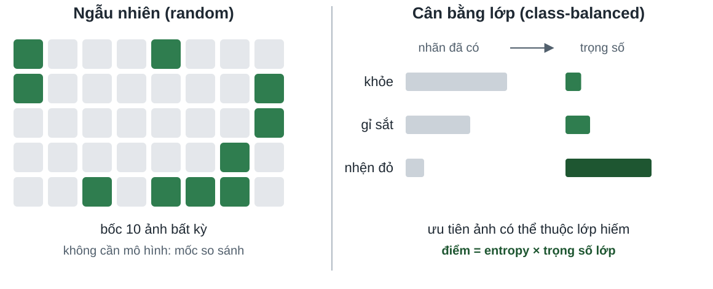

<!--
Random: chọn ngẫu nhiên, không cần mô hình. Đây là mốc để biết các chiến lược khác có đáng dùng không.
Class-balanced theo Luo và cộng sự [43]: điểm entropy nhân với trọng số của lớp mô hình dự đoán, w_c = 1 / (m_c + 0,1·m), với m_c là số ảnh có nhãn của lớp c và m là tổng số ảnh có nhãn. Lớp càng ít nhãn (nhện đỏ) thì ảnh có khả năng thuộc lớp đó càng được ưu tiên.
Tỉ lệ lớp trên slide là minh hoạ.
-->

---

# Giả lập: chia dữ liệu

<!-- _footer: "[33] N. Beck, D. Sivasubramanian, A. Dani, G. Ramakrishnan, và R. Iyer, “Effective Evaluation of Deep Active Learning on Image Classification Tasks”. arXiv:2106.15324. ICML 2021 Workshop on Subset Selection in Machine Learning, 2021. [34] P. Munjal, N. Hayat, M. Hayat, J. Sourati, và S. Khan, “Towards Robust and Reproducible Active Learning Using Neural Networks”, trong 2022 IEEE/CVF Conference on Computer Vision and Pattern Recognition (CVPR), IEEE, 2022, tr 223–232. [44] X. Zhan, H. Liu, Q. Li, và A. B. Chan, “A Comparative Survey: Benchmarking for Pool-based Active Learning”, trong Proceedings of the Thirtieth International Joint Conference on Artificial Intelligence (IJCAI-21), 2021, tr 4679–4686." -->

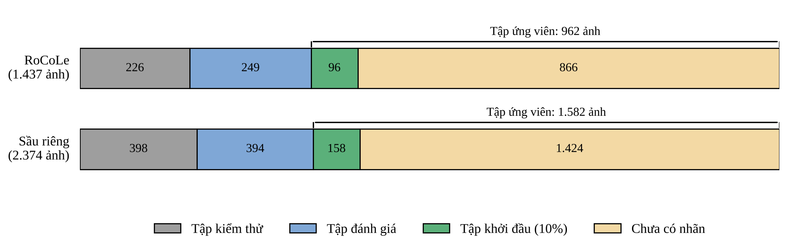

<!--
Hai bộ dữ liệu đều đã có nhãn đầy đủ. Giả lập che nhãn của tập ứng viên, khi chiến lược chọn ảnh nào thì mở nhãn ảnh đó, thay cho chuyên gia gán nhãn.
Tập kiểm thử giống hệt phần đánh giá mô hình. Tập đánh giá là một fold cố định, chỉ dùng để dừng sớm. Bốn fold còn lại là tập ứng viên.
Vòng đầu lấy ngẫu nhiên 10% tập ứng viên làm tập khởi đầu, mỗi lớp ít nhất một ảnh: 96 ảnh với RoCoLe, 158 ảnh với sầu riêng.
-->

---

# Giả lập: một vòng chọn ảnh

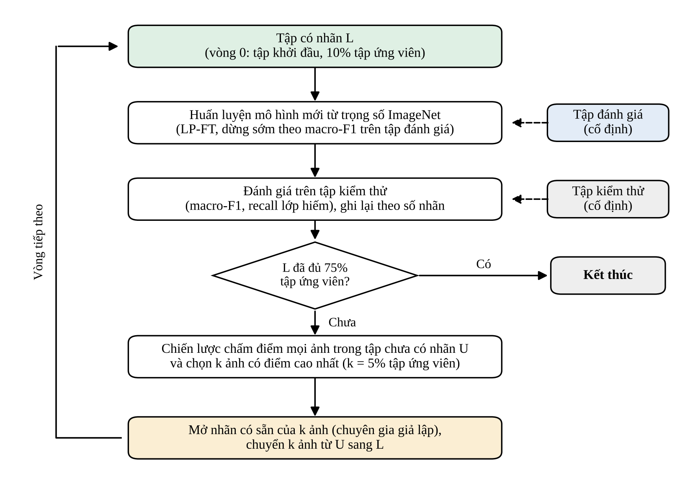

<!--
Mỗi vòng có ba bước. Huấn luyện một DeiT-Tiny mới từ trọng số ImageNet trên tập có nhãn hiện tại, bằng LP-FT. Chấm điểm trên tập kiểm thử. Rồi chiến lược chấm điểm mọi ảnh chưa có nhãn và chọn 5% tập ứng viên có điểm cao nhất.
Lặp 13 lần chọn, từ 10% đến 75% tập ứng viên. Dừng ở 75% vì càng gần 100% thì tập có nhãn của các chiến lược càng giống nhau.
Mỗi chiến lược chạy 5 seed trên mỗi bộ dữ liệu.
-->

---

# RoCoLe: macro-F1 theo số nhãn

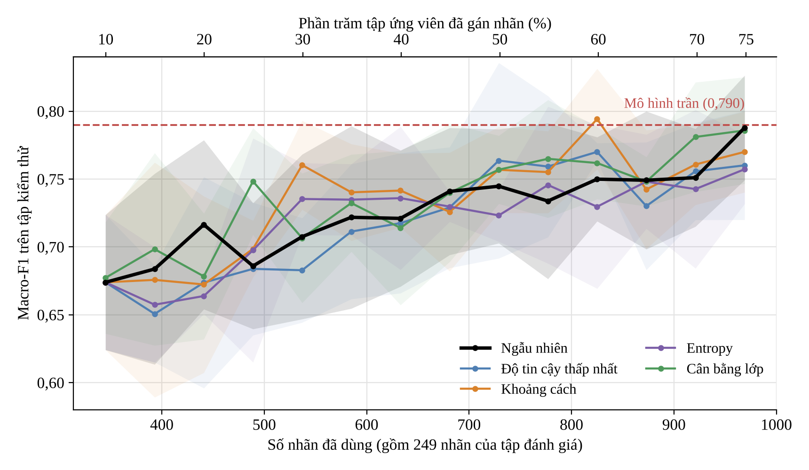

<!--
Đường đen là chọn ngẫu nhiên, đường đỏ đứt là mô hình trần, tức mô hình học trên toàn bộ tập ứng viên: 0,790.
Các đường đan vào nhau, và vùng khoảng tin cậy chồng lên nhau gần như ở mọi vòng. Không chiến lược nào nằm hẳn trên đường ngẫu nhiên.
-->

---

# RoCoLe: không chiến lược nào hơn rõ

<!-- _footer: "[44] X. Zhan, H. Liu, Q. Li, và A. B. Chan, “A Comparative Survey: Benchmarking for Pool-based Active Learning”, trong Proceedings of the Thirtieth International Joint Conference on Artificial Intelligence (IJCAI-21), 2021, tr 4679–4686." -->

| Chiến lược | AUBC | Chênh lệch AUBC | Macro-F1 ở 75% | Chênh lệch ở 75% |
|---|---|---|---|---|
| Cân bằng lớp | 0,736 ± 0,009 | +0,010 ± 0,026 | 0,786 ± 0,039 | −0,002 ± 0,063 |
| Khoảng cách | 0,734 ± 0,013 | +0,008 ± 0,028 | 0,770 ± 0,030 | −0,018 ± 0,045 |
| **Ngẫu nhiên** | 0,726 ± 0,022 | | 0,788 ± 0,039 | |
| Entropy | 0,720 ± 0,012 | −0,006 ± 0,020 | 0,757 ± 0,026 | **−0,031 ± 0,025** |
| Độ tin cậy thấp nhất | 0,719 ± 0,023 | −0,007 ± 0,027 | 0,760 ± 0,040 | **−0,028 ± 0,027** |

<!--
AUBC là diện tích dưới đường macro-F1 theo số nhãn: đường đi lên càng nhanh thì AUBC càng cao. Chênh lệch tính so với chọn ngẫu nhiên, cùng seed.
AUBC của năm chiến lược chỉ cách nhau 0,017. Mọi chênh lệch AUBC đều có khoảng tin cậy chứa 0, nên không chiến lược nào hơn chọn ngẫu nhiên một cách rõ ràng.
Ở 75%, entropy và độ tin cậy thấp nhất còn thấp hơn chọn ngẫu nhiên.
-->

---

# RoCoLe: lớp nhện đỏ

| Chiến lược | Tỷ lệ ảnh nhện đỏ được chọn | Recall lớp nhện đỏ |
|---|---|---|
| Cân bằng lớp | **12,8%** | 0,46 ± 0,13 |
| Khoảng cách | **12,8%** | 0,42 ± 0,11 |
| Độ tin cậy thấp nhất | 11,6% | 0,43 ± 0,12 |
| Entropy | 11,0% | 0,36 ± 0,06 |
| Ngẫu nhiên | 9,5% | 0,52 ± 0,14 |

Tập ứng viên có 10,0% ảnh nhện đỏ. Mô hình trần: recall 0,53 ± 0,06.

<!--
Lớp nhện đỏ là lớp hiếm của RoCoLe, chiếm 10% tập ứng viên.
Cân bằng lớp và khoảng cách chọn nhiều ảnh nhện đỏ nhất, 12,8%, cao hơn chọn ngẫu nhiên.
Nhưng chọn nhiều ảnh nhện đỏ hơn chưa làm recall lớp này tăng: các chiến lược AL vẫn chưa vượt chọn ngẫu nhiên.
-->

---

# Sầu riêng: macro-F1 theo số nhãn

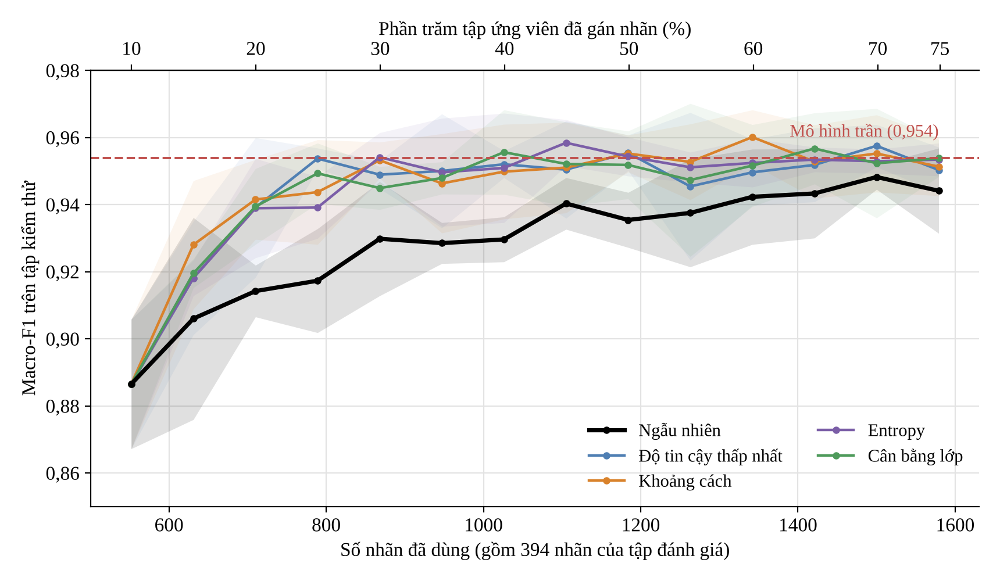

<!--
Ngay vòng 0, với 10% tập ứng viên, mô hình đã đạt macro-F1 trung bình 0,887, bằng khoảng 93% mô hình trần.
Từ vòng 1 trở đi, cả bốn chiến lược AL đều nằm trên đường chọn ngẫu nhiên.
-->

---

# Sầu riêng: AL hơn chọn ngẫu nhiên

| Chiến lược | AUBC | Chênh lệch AUBC | Macro-F1 ở 75% | Chênh lệch ở 75% |
|---|---|---|---|---|
| Khoảng cách | 0,947 ± 0,005 | **+0,017 ± 0,005** | 0,951 ± 0,009 | +0,007 ± 0,013 |
| Entropy | 0,946 ± 0,003 | **+0,016 ± 0,007** | 0,953 ± 0,005 | +0,009 ± 0,015 |
| Độ tin cậy thấp nhất | 0,945 ± 0,003 | **+0,016 ± 0,007** | 0,950 ± 0,007 | +0,006 ± 0,013 |
| Cân bằng lớp | 0,945 ± 0,005 | **+0,016 ± 0,006** | 0,954 ± 0,006 | +0,010 ± 0,012 |
| **Ngẫu nhiên** | 0,930 ± 0,007 | | 0,944 ± 0,013 | |

<!--
Cả bốn chiến lược AL có AUBC cao hơn chọn ngẫu nhiên khoảng 0,016 đến 0,017, và khoảng tin cậy của chênh lệch đều nằm trên 0.
Bốn chiến lược cho kết quả gần như nhau. Đến 75% thì chênh lệch với chọn ngẫu nhiên nhỏ dần, vì tập có nhãn của các chiến lược ngày càng giống nhau.
-->

---

# Kết quả: tùy bộ dữ liệu

<!-- _footer: "[33] N. Beck, D. Sivasubramanian, A. Dani, G. Ramakrishnan, và R. Iyer, “Effective Evaluation of Deep Active Learning on Image Classification Tasks”. arXiv:2106.15324. ICML 2021 Workshop on Subset Selection in Machine Learning, 2021. [34] P. Munjal, N. Hayat, M. Hayat, J. Sourati, và S. Khan, “Towards Robust and Reproducible Active Learning Using Neural Networks”, trong 2022 IEEE/CVF Conference on Computer Vision and Pattern Recognition (CVPR), IEEE, 2022, tr 223–232." -->

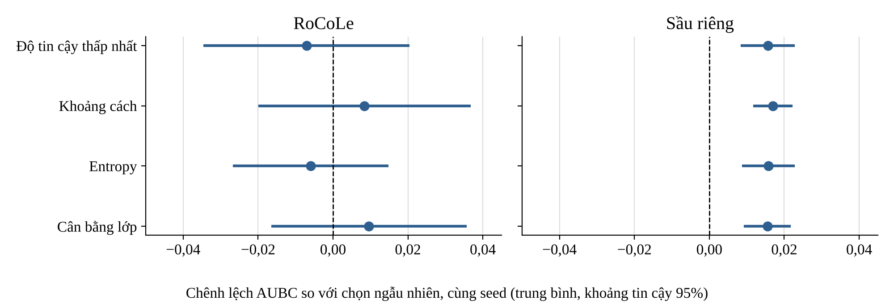

**Triển khai cả 5 chiến lược lên nền tảng MLOps để kỹ sư chọn theo bộ dữ liệu**

<!--
Hình so sánh chênh lệch AUBC với chọn ngẫu nhiên trên hai bộ dữ liệu. Đoạn nằm hẳn bên phải đường 0 nghĩa là chiến lược tốt hơn chọn ngẫu nhiên.
Trên RoCoLe, mọi đoạn đều cắt đường 0, giống nhận xét của Munjal: khi mô hình được điều chuẩn mạnh, AL không còn hơn rõ.
Trên sầu riêng, mọi đoạn nằm bên phải đường 0, giống Beck: các chiến lược bất định đơn giản đã tiết kiệm nhãn hơn chọn ngẫu nhiên, và bốn chiến lược gần nhau.
Vì không có một chiến lược thắng ở mọi bộ dữ liệu, nền tảng cho phép chọn cả năm chiến lược.
-->

---

<!-- _class: part -->

# Phần IV. Nền tảng MLOps

Nhu cầu, giải pháp và demo

---

<!-- _class: part -->

# IV.1 Vì sao cần hệ thống

Từ thí nghiệm học chủ động đến một nền tảng chạy thật

---

# Ai dùng hệ thống?

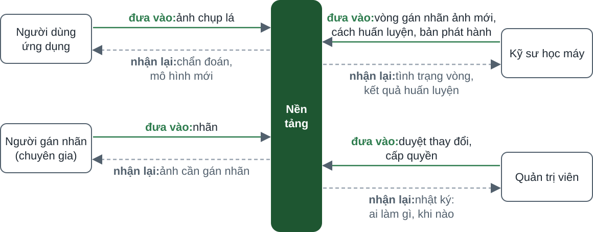

---

# Là một người dùng ứng dụng, tôi muốn…


---

# Là một người gán nhãn, tôi muốn…


---

# Là một kỹ sư học máy, tôi muốn…


---

# Là một quản trị viên, tôi muốn…


---

# Hành trình: từ ảnh chụp đến mô hình tốt hơn


---

<!-- _class: part -->

# IV.2 Giải pháp

Từ nhu cầu đến thiết kế hệ thống

---

<!-- _class: matrix -->

# Tổng quan giải pháp

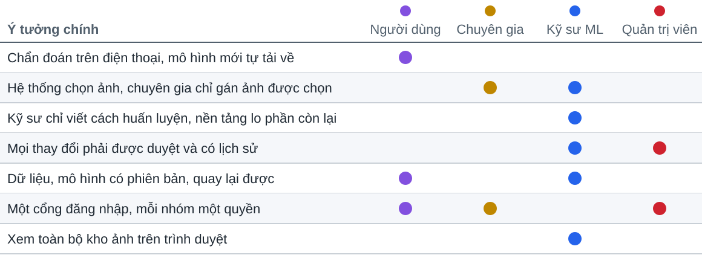

---

# Kiến trúc tổng thể

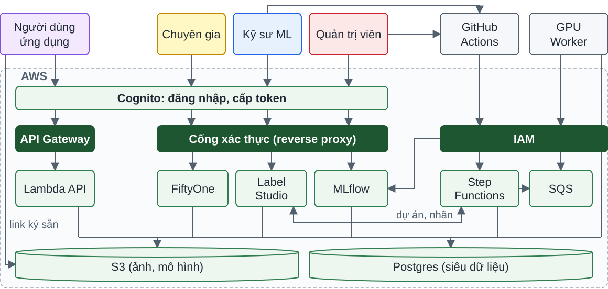

---

# Công cụ mã nguồn mở

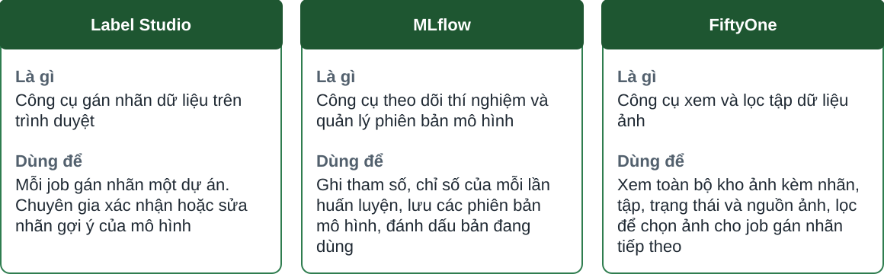

---

<!-- _class: cards -->

# Ứng dụng di động

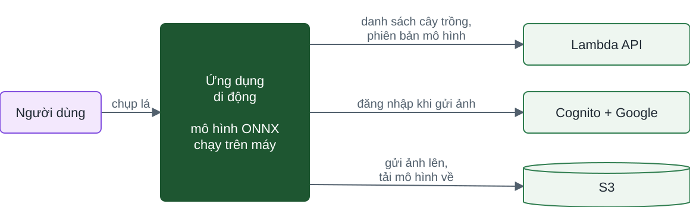

- Mô hình chạy trên máy: chẩn đoán cả khi không có mạng
- Không cần tài khoản để chẩn đoán, chỉ đăng nhập khi gửi ảnh
- Mô hình mới tự tải về, không cần cập nhật ứng dụng

---

# Đăng nhập và phân quyền

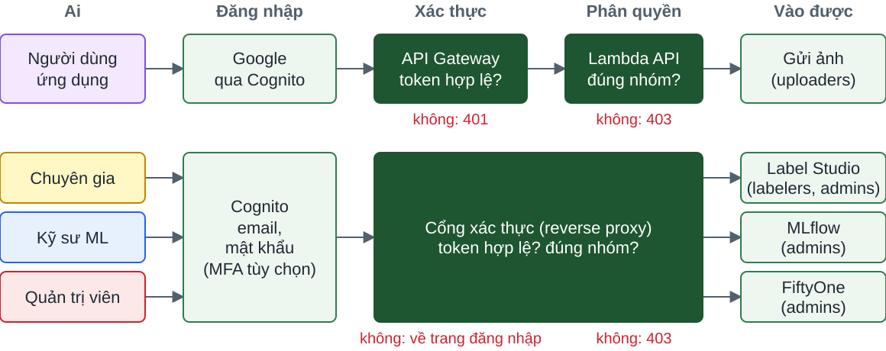

---

<!-- _class: cards -->

# Vận hành bằng pull request

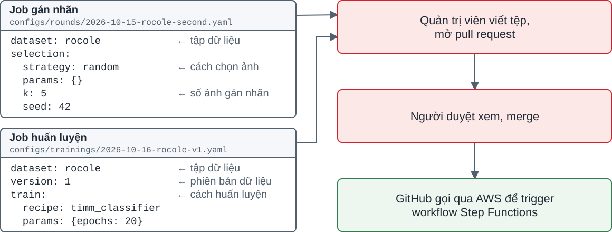

- Lịch sử Git: ai chạy job nào, lúc nào
- Phát hành mô hình cũng vậy: sửa một tệp, merge
- Quay lại bản trước: revert pull request

<!--
Gán nhãn và huấn luyện là hai job riêng, mỗi job một tệp nhỏ. Job gán nhãn ghi tập dữ liệu, cách chọn ảnh và số ảnh. Job huấn luyện ghi tập dữ liệu, phiên bản dữ liệu và cách huấn luyện. Quản trị viên không mở trang quản trị nào: viết tệp, mở pull request, được duyệt và merge thì GitHub gọi AWS để chạy job. Phát hành mô hình làm giống hệt.
-->

---

<!-- _class: cards -->

# Job gán nhãn và job huấn luyện

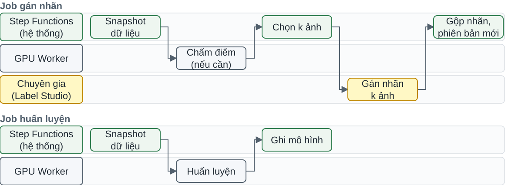

- Job gán nhãn tạo phiên bản dữ liệu mới, job huấn luyện tạo mô hình mới
- Chấm điểm dùng mô hình mới nhất, chọn ngẫu nhiên thì không cần mô hình
- Mỗi tập dữ liệu chỉ có một job gán nhãn đang chạy

<!--
Hai job chạy độc lập. Job gán nhãn: hệ thống chụp lại dữ liệu, GPU Worker chấm điểm ảnh chưa có nhãn bằng mô hình mới nhất (chọn ngẫu nhiên thì bỏ qua bước này), hệ thống chọn k ảnh, chuyên gia gán nhãn trên Label Studio, hệ thống gộp nhãn thành phiên bản dữ liệu mới. Job huấn luyện: chụp lại một phiên bản dữ liệu, GPU Worker huấn luyện, hệ thống ghi mô hình. Có thể gán nhãn nhiều lần rồi mới huấn luyện.
-->

---

<!-- _class: cards -->

# GPU Worker

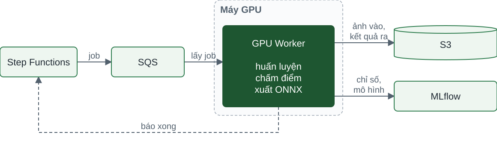

- Máy không mở cổng nào, tự lấy việc từ hàng đợi
- Máy tắt: job nằm chờ, chạy tiếp khi máy bật
- Mỗi job chạy đúng image Docker của commit

---

<!-- _class: cards -->

# Gán nhãn

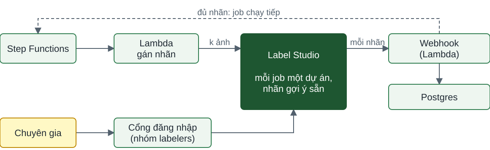

- Chuyên gia chỉ thấy ảnh của job gán nhãn
- Có sẵn nhãn gợi ý, chỉ cần xác nhận hoặc sửa
- Nhãn lưu ở Postgres, không chỉ trong Label Studio

---

<!-- _class: cards -->

# Theo dõi và phát hành mô hình

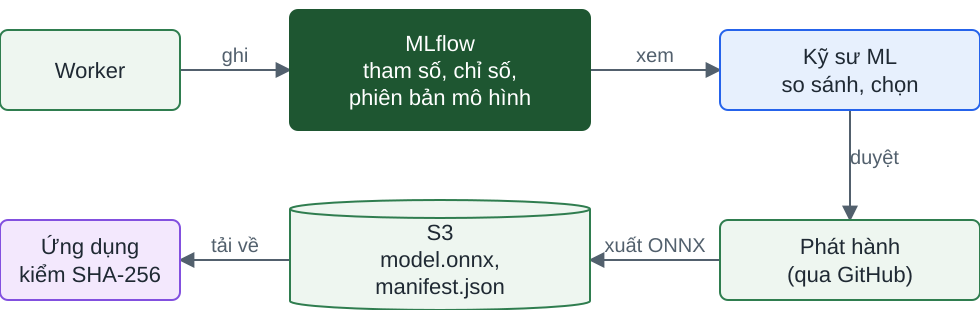

- Mọi lần huấn luyện so sánh ở một chỗ
- Lịch sử phát hành chỉ thêm, không sửa
- Quay lại bản cũ bằng git revert

---

<!-- _class: cards -->

# Lưu trữ dữ liệu

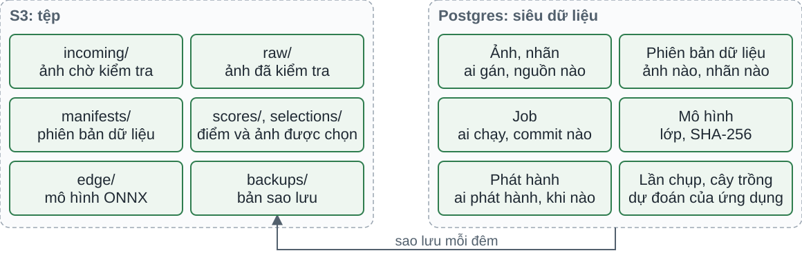

- Ảnh đặt tên theo SHA-256, không lưu trùng
- Phiên bản dữ liệu không bao giờ bị sửa
- Ổ dữ liệu riêng, sao lưu mỗi đêm

---

<!-- _class: cards -->

# Xem kho ảnh

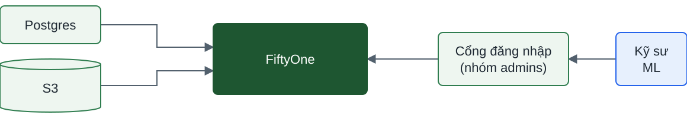

- Xem ảnh đã gán nhãn, chưa gán nhãn và ảnh mới gửi về
- Lọc theo lớp, tập, trạng thái, nguồn ảnh
- Chỉ để xem, dữ liệu gốc không đổi

---

<!-- _class: part -->

# IV.3 Demo

Một ảnh lá cà phê mới, chưa có trong tập dữ liệu

---

<!-- _class: cards -->

# Người dùng: đăng nhập và tải mô hình

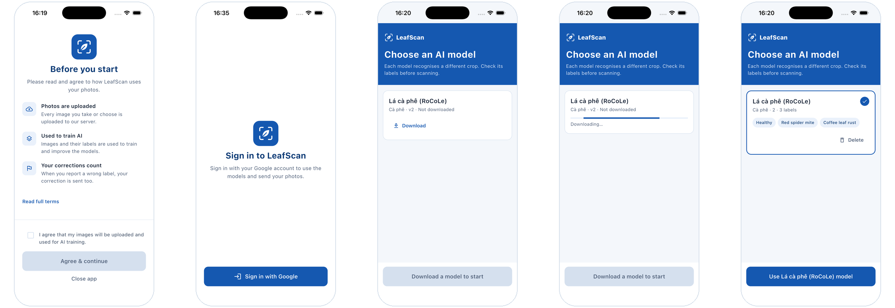

- Đồng ý gửi ảnh
- Đăng nhập bằng Google
- Chọn mô hình
- Tải về máy
- Chọn model để thực hiện dự đoán

<!--
Phải đăng nhập mới tải được mô hình. Ứng dụng chỉ hiện các mô hình đã phát hành trên hệ thống. Mô hình tải về một lần, sau đó chẩn đoán ngay trên điện thoại.
-->

---

<!-- _class: cards -->

# Người dùng: chẩn đoán ảnh mới

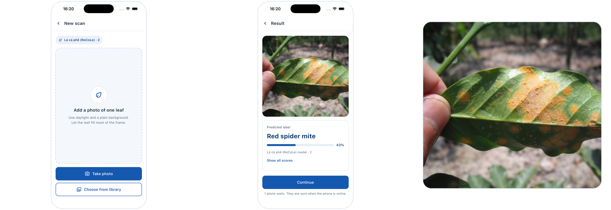

- Chọn ảnh một chiếc lá
- Kết quả ngay trên máy: Red spider mite, 43%
- Ảnh thật là gỉ sắt lá cà phê: mô hình đoán sai, ảnh được gửi về để gán nhãn

<!--
Đây đúng là loại ảnh mà học chủ động cần: mô hình chưa chắc chắn. Ảnh nằm trong hàng đợi trên máy và tự gửi khi có mạng, sau đó vào kho ảnh chưa gán nhãn.
-->

---

# Xem kho ảnh trong FiftyOne

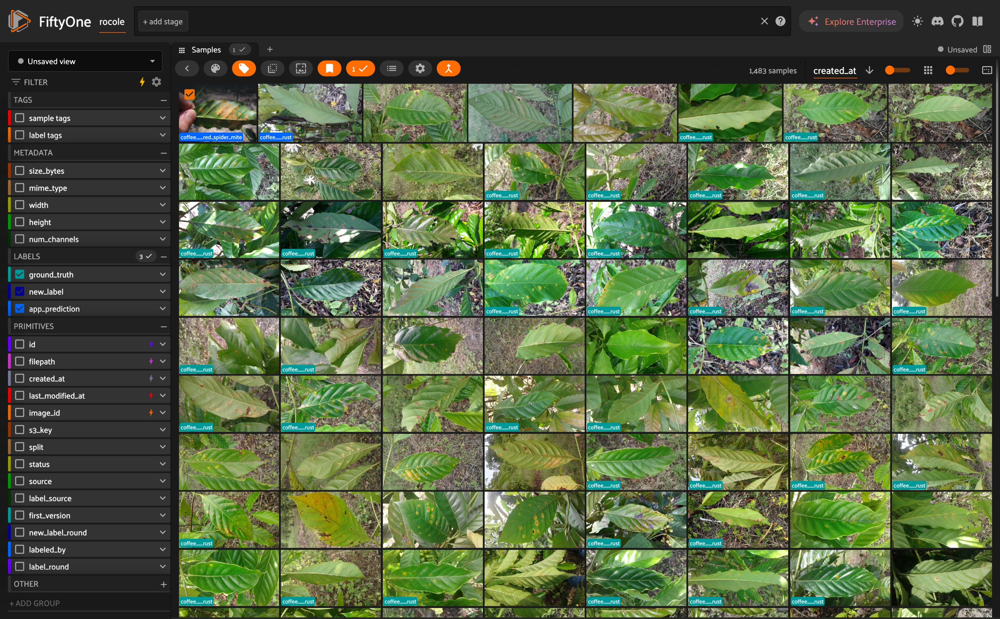

<!--
Ảnh vừa gửi từ ứng dụng nằm đầu danh sách, kèm dự đoán của ứng dụng.
-->

---

# Xem kho ảnh trong FiftyOne: các trường chính

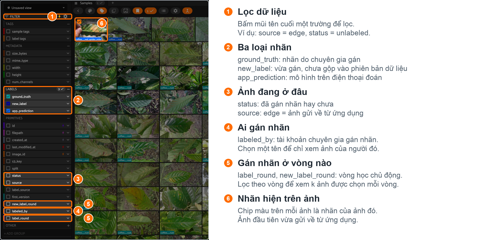

<!--
Lọc theo source = edge để xem ảnh từ ứng dụng, status = unlabeled để xem ảnh chưa gán nhãn. ground_truth là nhãn do chuyên gia gán. labeled_by cho biết ai gán, label_round cho biết gán ở vòng nào.
-->

---

# Quản trị viên: mở job gán nhãn bằng một pull request

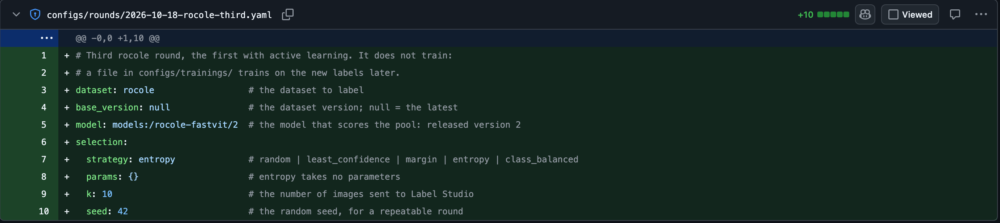

<!--
Quản trị viên không tự chọn ảnh. Một tệp mới trong configs/rounds/ ghi tập dữ liệu, mô hình chấm điểm, cách chọn (entropy), k = 10 và seed. CI kiểm tra tệp trước khi merge. Duyệt và merge trên GitHub là bước phê duyệt và là lịch sử.
-->

---

# Merge xong: GitHub Actions khởi động job

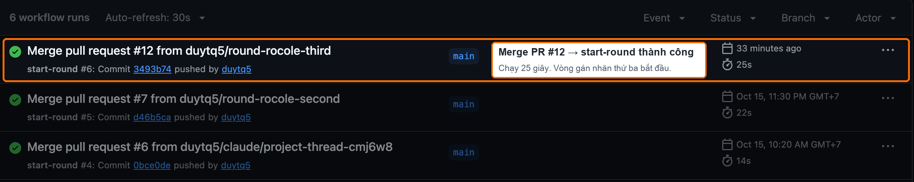

<!--
Merge vào main chạy workflow start-round. Workflow kiểm tra tệp, ghi job cùng người merge và commit, rồi khởi động job trong 25 giây. Job chấm điểm các ảnh, chọn 10 ảnh và mở project Label Studio ở slide sau.
-->

---

# Label Studio: mỗi job gán nhãn là một project

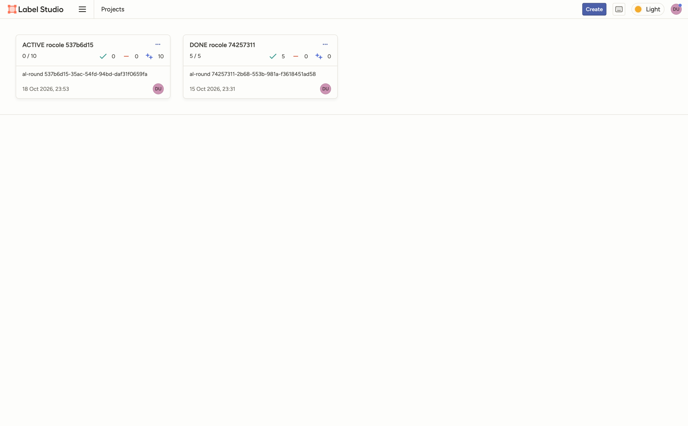

<!--
Mỗi job gán nhãn tạo một project. Tên project là ACTIVE khi job còn chờ nhãn, và đổi thành DONE khi đủ nhãn. Chuyên gia mở project ACTIVE để bắt đầu.
-->

---

# Chuyên gia gán nhãn trong Label Studio

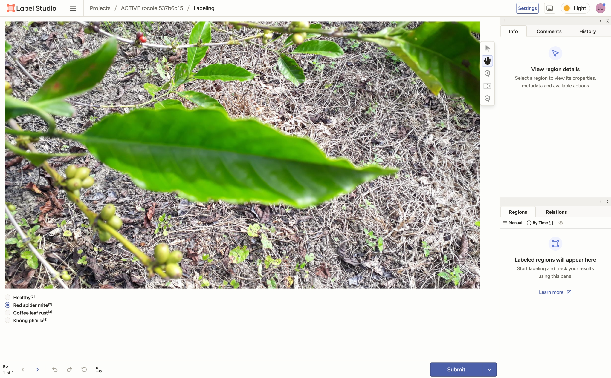

<!--
Chuyên gia bấm Label All Tasks. Label Studio đưa từng ảnh một, mỗi ảnh cho một người.
-->

---

# Gán nhãn: một ảnh, một nhãn

<!--
Dự đoán của mô hình được chọn sẵn, chuyên gia chỉ cần xác nhận hoặc sửa. Submit lưu nhãn và hiện ảnh tiếp theo. Khi đủ 10 ảnh, job gộp nhãn thành một phiên bản dữ liệu mới.
-->

---

# Kỹ sư ML: mở job huấn luyện bằng một pull request

<!--
Kỹ sư ML không chạy huấn luyện bằng tay. Tệp ghi phiên bản dữ liệu, công thức và các tham số. CI kiểm tra tệp. Duyệt và merge trên GitHub là bước phê duyệt và là lịch sử. Sau khi merge, GitHub Actions khởi động job huấn luyện; GPU Worker huấn luyện và ghi lần chạy vào MLflow (slide sau).
-->

---

# Merge xong: GitHub Actions khởi động job huấn luyện

<!--
CI kiểm tra tệp trên pull request, rồi chạy lại trên main sau khi merge. Merge vào main chạy start-training. Workflow từ chối tệp có phiên bản dữ liệu chưa tồn tại, nên tệp huấn luyện chỉ được merge sau khi job gán nhãn đã gộp nhãn. Sau đó workflow ghi job huấn luyện kèm người merge và commit, rồi khởi động job. GPU Worker huấn luyện và ghi lần chạy vào MLflow (slide sau).
-->

---

# Kỹ sư ML: xem kết quả trong MLflow

<!--
GPU Worker ghi mọi lần huấn luyện vào đây. Kỹ sư ML so sánh accuracy và macro F1 trên validation và test với mô hình hiện tại, rồi mới quyết định phát hành. Các tag nối run với job, phiên bản dữ liệu và mã nguồn. Mô hình được đăng ký là phiên bản 3; phát hành nó là bước tiếp theo, bằng một pull request.
-->

---

# Quản trị viên: phát hành mô hình bằng một pull request

<!--
Tệp phát hành ghi mô hình và phiên bản mà ứng dụng tải về. Kỹ sư ML đã so sánh v3 với v2 trong MLflow trước. Merge chạy workflow release: GPU Worker chuyển mô hình sang ONNX, kiểm tra ONNX và PyTorch cho cùng dự đoán trên ảnh validation, tải lên, rồi ghi lần phát hành kèm người merge và commit. Quay lại bản cũ: revert pull request. Nói thật: v3 chỉ ngang v2, vì 10 nhãn mới gần như không đổi các chỉ số.
-->

---

<!-- _class: cards -->

# Người dùng: ứng dụng nhận mô hình mới

- 1 · Đang dùng phiên bản 2
- 2 · Ứng dụng thấy bản phát hành mới
- 3 · Tải mô hình ONNX về máy, kiểm tra sha256

<!--
Ứng dụng kiểm tra các mô hình đã phát hành khi mở. Người dùng chọn cập nhật. Mô hình được tải về và kiểm tra trên điện thoại, sau đó chẩn đoán chạy ngay trên máy, không cần mạng. Slide sau: chụp lại cùng chiếc lá với mô hình mới.
-->

---

<!-- _class: part -->

# Phần V. Hướng phát triển

Đang soạn

<!--
Ý chính từ demo: gán nhãn không hiện gợi ý của mô hình (tránh thiên lệch); mỗi chuyên gia chỉ thấy một ảnh một lúc; job gán nhãn chỉ trên ảnh từ ứng dụng, dùng lại dự đoán của điện thoại; worker không cần SSM tunnel và khoá IAM dài hạn; 10 nhãn mới gần như không đổi chỉ số của v3.
-->
