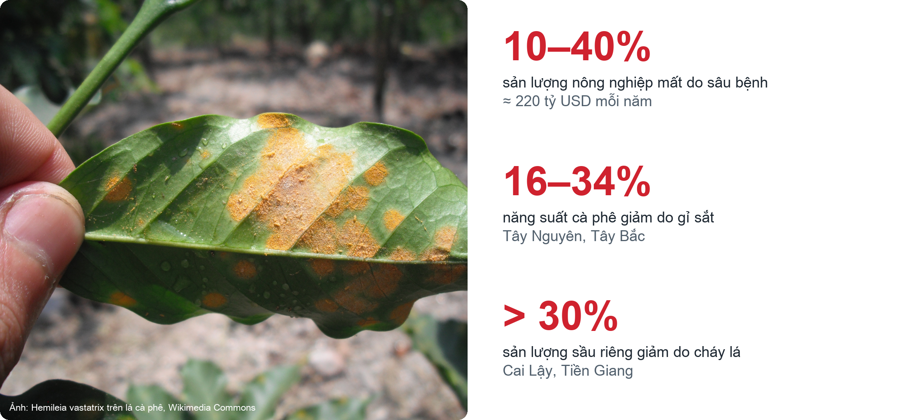
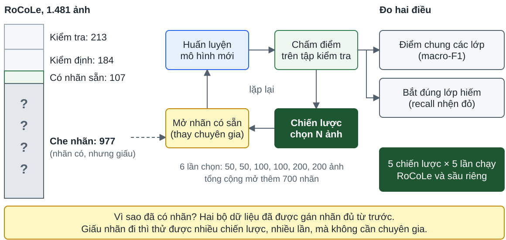

# Nội dung

- I. Giới thiệu
- II. Đánh giá mô hình thị giác máy tính
- III. Mô phỏng học chủ động
- IV. Nền tảng MLOps
- V. Hướng phát triển

---

<!-- _class: part -->
<!-- _paginate: false -->

# Phần I. Giới thiệu

Bệnh trên lá và chẩn đoán trên điện thoại

<!--
Tài liệu: writing/chapters/01-intro.md (mục 1.1 Đặt vấn đề, 1.2 Mục tiêu, 1.3 Phạm vi).
-->

---

# Bệnh trên lá: mất mùa mỗi năm

<!--
Sâu bệnh làm mất 10–40% sản lượng nông nghiệp trước thu hoạch, khoảng 220 tỷ USD mỗi năm (CABI). Ở Việt Nam: gỉ sắt làm năng suất cà phê giảm 16–34%; cháy lá làm sản lượng sầu riêng ở Cai Lậy giảm hơn 30%, từ 20 tấn còn 13–14 tấn. Nông dân vẫn phát hiện bằng mắt, khi bệnh đã lan. Nguồn: chapters/01-intro.md, mục 1.1.
-->

---

<!-- _class: part -->
<!-- _paginate: false -->

# Phần II. Đánh giá mô hình thị giác máy tính

Đang soạn

<!--
Tài liệu: repo thesis/, giai đoạn 2: so sánh 10 kiến trúc, chọn FastViT-T8 (reports/, papers/).
-->

---

<!-- _class: part -->
<!-- _paginate: false -->

# Phần III. Mô phỏng học chủ động

Gán nhãn ảnh nào trước khi chuyên gia có hạn?

---

# Vấn đề: ít ảnh lá thực địa có nhãn

<!--
Ảnh lá ngoài vườn khác ảnh phòng thí nghiệm: nền rối, ánh sáng thay đổi, lá che nhau. Mô hình học trên ảnh nền trơn chẩn đoán kém ngoài thực địa.
Bộ thực địa thì rất nhỏ: sầu riêng (dữ liệu Việt Nam) 2.595 ảnh, RoCoLe 1.560 ảnh, so với 54.306 ảnh của PlantVillage. Gán thêm nhãn cần chuyên gia nông nghiệp, nên tốn kém.
Nguồn: PlantVillage (Hughes & Salathé, 2015); RoCoLe (Parraga-Alava et al., 2019).
-->

---

# Cơ hội và khó khăn

<!--
Cơ hội: người dùng ứng dụng chụp ảnh lá ngoài vườn mỗi ngày. Đó chính là ảnh thực địa ta đang thiếu.
Khó khăn: muốn dùng được thì ảnh phải có nhãn, mà nhãn cần chuyên gia nông nghiệp. Chuyên gia ít và đắt; ảnh gửi về nhiều ảnh mờ, tối, không phải lá; và số ảnh vượt xa số ảnh chuyên gia gán kịp.
Vì vậy không thể gán hết: phải chọn ra một phần nhỏ đáng gán nhất.
-->

---

# Câu hỏi

<!--
Chuyên gia chỉ gán được một ít ảnh mỗi lần, ví dụ 10 ảnh. Trong pool có hàng trăm ảnh chưa nhãn.
Chọn ngẫu nhiên thì dễ phí nhãn vào ảnh mô hình đã biết. Câu hỏi là: chọn 10 ảnh nào để mô hình học được nhiều nhất?
-->

---

# Học chủ động: để mô hình chọn ảnh cần gán

<!--
Học chủ động (Active Learning): thay vì chọn ngẫu nhiên, để mô hình chọn ảnh nào đáng gán nhãn nhất.
Vòng lặp: mô hình chấm điểm mọi ảnh chưa nhãn, chọn 10 ảnh "phù hợp" nhất theo một chiến lược, chuyên gia gán nhãn, huấn luyện lại, rồi lặp lại.
"Phù hợp" tùy chiến lược: ảnh mô hình kém chắc nhất, hoặc ảnh có thể thuộc lớp hiếm. Hai slide chiến lược phía sau nói rõ.
-->

---

# Vì sao cần giả lập?

<!--
Học chủ động không cho cùng một kết quả trên mọi bộ dữ liệu. Werner và cộng sự (2024) so sánh nhiều miền dữ liệu và thấy chiến lược tốt nhất đổi theo từng bộ. Lüth và cộng sự (2023) chỉ ra phân bố lớp quyết định học chủ động giúp được bao nhiêu, và lợi ích lớn nhất khi dữ liệu lệch lớp. Hacohen và cộng sự (2022) cho thấy lúc ít nhãn và lúc nhiều nhãn cần hai cách chọn ngược nhau.
Hai bài khác cũng nói kết quả còn tranh luận: Gashi và cộng sự (2024, "Deep Active Learning: A Reality Check") thấy entropy là mốc khó vượt, có cách phức tạp còn thua random; Mittal và cộng sự (2025, IJCV) thấy khi có tăng cường dữ liệu mạnh, chọn chủ động gần bằng random.
Vì vậy cần thực nghiệm trên chính bộ dữ liệu: RoCoLe (lệch lớp, nhện đỏ hiếm) và sầu riêng (khá cân bằng).
-->

---

# Chiến lược bất định: chọn ảnh mô hình phân vân

<!--
Ba chiến lược bất định (uncertainty sampling) dùng cùng một lần suy luận trên pool, chỉ khác cách tính điểm từ vector xác suất.
Least confidence: 1 trừ xác suất cao nhất. Margin: khoảng cách giữa hai xác suất đầu, càng nhỏ càng phân vân. Entropy: độ dàn đều của cả phân phối.
Điểm số trên slide là ví dụ minh hoạ.
-->

---

# Mốc so sánh và lớp hiếm

<!--
Random: chọn ngẫu nhiên, không cần mô hình. Đây là mốc để biết các chiến lược khác có đáng dùng không.
Class-balanced: điểm entropy nhân với trọng số nghịch với tần suất lớp trong tập đã gán nhãn, freq(y) = (n_y + 1) / (N + C). Lớp càng ít nhãn (nhện đỏ) thì ảnh có khả năng thuộc lớp đó càng được ưu tiên.
Tỉ lệ lớp trên slide là minh hoạ.
-->

---

# Giả lập: giấu nhãn rồi mở dần

<!--
Bộ dữ liệu đã có nhãn đầy đủ, nên giả lập che nhãn của kho ảnh rồi mở dần, thay cho việc hỏi chuyên gia (pool-based, theo Karamcheti và cộng sự, ACL 2021).
Chia RoCoLe 1.481 ảnh: test 213 (14,4%), validation 184 (12,4%), seed set 107 ảnh (khoảng 10% pool) có nhãn từ đầu, còn 977 ảnh che nhãn. Sầu riêng 2.595 ảnh chia cùng cách (test 15,2%, validation 12,1%, seed 7,3%).
Mỗi vòng huấn luyện mô hình mới từ trọng số ImageNet trên toàn bộ ảnh đã có nhãn, đo trên test cố định, rồi chiến lược chọn N ảnh để mở nhãn. 7 vòng huấn luyện, 6 lần chọn.
Chỉ số: macro-F1, recall lớp nhện đỏ (red spider mite), AUBC (diện tích dưới đường macro-F1 theo số nhãn) và số nhãn cần để đạt ngưỡng (macro-F1 ≥ 0,80, recall lớp hiếm ≥ 0,70).
Mốc trần (ceiling): huấn luyện một lần trên toàn bộ kho ảnh có nhãn. 5 chiến lược × 5 seed × 2 bộ dữ liệu.
-->

---

<!-- _class: part -->
<!-- _paginate: false -->

# Phần IV. Nền tảng MLOps

Nhu cầu, giải pháp và demo

---

<!-- _class: part -->
<!-- _paginate: false -->

# IV.1 Vì sao cần hệ thống

Từ thí nghiệm học chủ động đến một nền tảng chạy thật

---

# Ai dùng hệ thống?

---

# Là một người dùng ứng dụng, tôi muốn…

---

# Là một người gán nhãn, tôi muốn…

---

# Là một kỹ sư học máy, tôi muốn…

---

# Là một quản trị viên, tôi muốn…

---

# Hành trình: từ ảnh chụp đến mô hình tốt hơn

---

<!-- _class: part -->
<!-- _paginate: false -->

# IV.2 Giải pháp

Từ nhu cầu đến thiết kế hệ thống

---

<!-- _class: matrix -->

# Tổng quan giải pháp

---

# Kiến trúc tổng thể

---

# Công cụ mã nguồn mở

---

<!-- _class: cards -->

# Ứng dụng di động

- Mô hình chạy trên máy: chẩn đoán cả khi không có mạng
- Không cần tài khoản để chẩn đoán, chỉ đăng nhập khi gửi ảnh
- Mô hình mới tự tải về, không cần cập nhật ứng dụng

---

# Đăng nhập và phân quyền

---

<!-- _class: cards -->

# Vận hành bằng pull request

- Lịch sử Git: ai chạy job nào, lúc nào
- Phát hành mô hình cũng vậy: sửa một tệp, merge
- Quay lại bản trước: revert pull request

<!--
Gán nhãn và huấn luyện là hai job riêng, mỗi job một tệp nhỏ. Job gán nhãn ghi tập dữ liệu, cách chọn ảnh và số ảnh. Job huấn luyện ghi tập dữ liệu, phiên bản dữ liệu và cách huấn luyện. Quản trị viên không mở trang quản trị nào: viết tệp, mở pull request, được duyệt và merge thì GitHub gọi AWS để chạy job. Phát hành mô hình làm giống hệt.
-->

---

<!-- _class: cards -->

# Job gán nhãn và job huấn luyện

- Job gán nhãn tạo phiên bản dữ liệu mới, job huấn luyện tạo mô hình mới
- Chấm điểm dùng mô hình mới nhất, chọn ngẫu nhiên thì không cần mô hình
- Mỗi tập dữ liệu chỉ có một job gán nhãn đang chạy

<!--
Hai job chạy độc lập. Job gán nhãn: hệ thống chụp lại dữ liệu, GPU Worker chấm điểm ảnh chưa có nhãn bằng mô hình mới nhất (chọn ngẫu nhiên thì bỏ qua bước này), hệ thống chọn k ảnh, chuyên gia gán nhãn trên Label Studio, hệ thống gộp nhãn thành phiên bản dữ liệu mới. Job huấn luyện: chụp lại một phiên bản dữ liệu, GPU Worker huấn luyện, hệ thống ghi mô hình. Có thể gán nhãn nhiều lần rồi mới huấn luyện.
-->

---

<!-- _class: cards -->

# GPU Worker

- Máy không mở cổng nào, tự lấy việc từ hàng đợi
- Máy tắt: job nằm chờ, chạy tiếp khi máy bật
- Mỗi job chạy đúng image Docker của commit

---

<!-- _class: cards -->

# Gán nhãn

- Chuyên gia chỉ thấy ảnh của job gán nhãn
- Có sẵn nhãn gợi ý, chỉ cần xác nhận hoặc sửa
- Nhãn lưu ở Postgres, không chỉ trong Label Studio

---

<!-- _class: cards -->

# Theo dõi và phát hành mô hình

- Mọi lần huấn luyện so sánh ở một chỗ
- Lịch sử phát hành chỉ thêm, không sửa
- Quay lại bản cũ bằng git revert

---

<!-- _class: cards -->

# Lưu trữ dữ liệu

- Ảnh đặt tên theo SHA-256, không lưu trùng
- Phiên bản dữ liệu không bao giờ bị sửa
- Ổ dữ liệu riêng, sao lưu mỗi đêm

---

<!-- _class: cards -->

# Xem kho ảnh

- Xem ảnh đã gán nhãn, chưa gán nhãn và ảnh mới gửi về
- Lọc theo lớp, tập, trạng thái, nguồn ảnh
- Chỉ để xem, dữ liệu gốc không đổi

---

<!-- _class: part -->
<!-- _paginate: false -->

# IV.3 Demo

Một ảnh lá cà phê mới, chưa có trong tập dữ liệu

---

<!-- _class: cards -->

# Người dùng: đăng nhập và tải mô hình

- Đồng ý gửi ảnh
- Đăng nhập bằng Google
- Chọn mô hình
- Tải về máy
- Chọn model để thực hiện dự đoán

<!--
Phải đăng nhập mới tải được mô hình. Ứng dụng chỉ hiện các mô hình đã phát hành trên hệ thống. Mô hình tải về một lần, sau đó chẩn đoán ngay trên điện thoại.
-->

---

<!-- _class: cards -->

# Người dùng: chẩn đoán ảnh mới

- Chọn ảnh một chiếc lá
- Kết quả ngay trên máy: Red spider mite, 43%
- Ảnh thật là gỉ sắt lá cà phê: mô hình đoán sai, ảnh được gửi về để gán nhãn

<!--
Đây đúng là loại ảnh mà học chủ động cần: mô hình chưa chắc chắn. Ảnh nằm trong hàng đợi trên máy và tự gửi khi có mạng, sau đó vào kho ảnh chưa gán nhãn.
-->

---

# Xem kho ảnh trong FiftyOne

<!--
Ảnh vừa gửi từ ứng dụng nằm đầu danh sách, kèm dự đoán của ứng dụng.
-->

---

# Xem kho ảnh trong FiftyOne: các trường chính

<!--
Lọc theo source = edge để xem ảnh từ ứng dụng, status = unlabeled để xem ảnh chưa gán nhãn. ground_truth là nhãn do chuyên gia gán. labeled_by cho biết ai gán, label_round cho biết gán ở vòng nào.
-->

---

# Quản trị viên: mở job gán nhãn bằng một pull request

<!--
Quản trị viên không tự chọn ảnh. Một tệp mới trong configs/rounds/ ghi tập dữ liệu, mô hình chấm điểm, cách chọn (entropy), k = 10 và seed. CI kiểm tra tệp trước khi merge. Duyệt và merge trên GitHub là bước phê duyệt và là lịch sử.
-->

---

# Merge xong: GitHub Actions khởi động job

<!--
Merge vào main chạy workflow start-round. Workflow kiểm tra tệp, ghi job cùng người merge và commit, rồi khởi động job trong 25 giây. Job chấm điểm các ảnh, chọn 10 ảnh và mở project Label Studio ở slide sau.
-->

---

# Label Studio: mỗi job gán nhãn là một project

<!--
Mỗi job gán nhãn tạo một project. Tên project là ACTIVE khi job còn chờ nhãn, và đổi thành DONE khi đủ nhãn. Chuyên gia mở project ACTIVE để bắt đầu.
-->

---

# Chuyên gia gán nhãn trong Label Studio

<!--
Chuyên gia bấm Label All Tasks. Label Studio đưa từng ảnh một, mỗi ảnh cho một người.
-->

---

# Gán nhãn: một ảnh, một nhãn

<!--
Dự đoán của mô hình được chọn sẵn, chuyên gia chỉ cần xác nhận hoặc sửa. Submit lưu nhãn và hiện ảnh tiếp theo. Khi đủ 10 ảnh, job gộp nhãn thành một phiên bản dữ liệu mới.
-->

---

# Kỹ sư ML: mở job huấn luyện bằng một pull request

<!--
Kỹ sư ML không chạy huấn luyện bằng tay. Tệp ghi phiên bản dữ liệu, công thức và các tham số. CI kiểm tra tệp. Duyệt và merge trên GitHub là bước phê duyệt và là lịch sử. Sau khi merge, GitHub Actions khởi động job huấn luyện; GPU Worker huấn luyện và ghi lần chạy vào MLflow (slide sau).
-->

---

# Merge xong: GitHub Actions khởi động job huấn luyện

<!--
CI kiểm tra tệp trên pull request, rồi chạy lại trên main sau khi merge. Merge vào main chạy start-training. Workflow từ chối tệp có phiên bản dữ liệu chưa tồn tại, nên tệp huấn luyện chỉ được merge sau khi job gán nhãn đã gộp nhãn. Sau đó workflow ghi job huấn luyện kèm người merge và commit, rồi khởi động job. GPU Worker huấn luyện và ghi lần chạy vào MLflow (slide sau).
-->

---

# Kỹ sư ML: xem kết quả trong MLflow

<!--
GPU Worker ghi mọi lần huấn luyện vào đây. Kỹ sư ML so sánh accuracy và macro F1 trên validation và test với mô hình hiện tại, rồi mới quyết định phát hành. Các tag nối run với job, phiên bản dữ liệu và mã nguồn. Mô hình được đăng ký là phiên bản 3; phát hành nó là bước tiếp theo, bằng một pull request.
-->

---

# Quản trị viên: phát hành mô hình bằng một pull request

<!--
Tệp phát hành ghi mô hình và phiên bản mà ứng dụng tải về. Kỹ sư ML đã so sánh v3 với v2 trong MLflow trước. Merge chạy workflow release: GPU Worker chuyển mô hình sang ONNX, kiểm tra ONNX và PyTorch cho cùng dự đoán trên ảnh validation, tải lên, rồi ghi lần phát hành kèm người merge và commit. Quay lại bản cũ: revert pull request. Nói thật: v3 chỉ ngang v2, vì 10 nhãn mới gần như không đổi các chỉ số.
-->

---

<!-- _class: cards -->

# Người dùng: ứng dụng nhận mô hình mới

- 1 · Đang dùng phiên bản 2
- 2 · Ứng dụng thấy bản phát hành mới
- 3 · Tải mô hình ONNX về máy, kiểm tra sha256

<!--
Ứng dụng kiểm tra các mô hình đã phát hành khi mở. Người dùng chọn cập nhật. Mô hình được tải về và kiểm tra trên điện thoại, sau đó chẩn đoán chạy ngay trên máy, không cần mạng. Slide sau: chụp lại cùng chiếc lá với mô hình mới.
-->

---

<!-- _class: part -->
<!-- _paginate: false -->

# Phần V. Hướng phát triển

Đang soạn

<!--
Ý chính từ demo: gán nhãn không hiện gợi ý của mô hình (tránh thiên lệch); mỗi chuyên gia chỉ thấy một ảnh một lúc; job gán nhãn chỉ trên ảnh từ ứng dụng, dùng lại dự đoán của điện thoại; worker không cần SSM tunnel và khoá IAM dài hạn; 10 nhãn mới gần như không đổi chỉ số của v3.
-->
